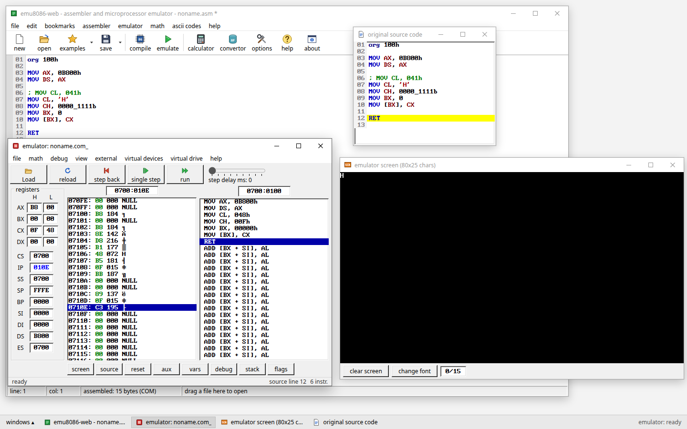

# emu8086-web — Free Online 8086 Emulator & Assembler

**emu8086-web** is a free, browser-based Intel 8086 assembler, emulator and debugger inspired by the classic
**EMU8086** software. You write 8086 assembly, assemble it, and run it one instruction at a time. Along the way
you can watch the registers, flags, memory, stack and the 80×25 text screen at `B800:0000`. Nothing needs to be
installed, and everything runs inside your browser tab.

**▶ Open the emulator: https://sergiulefter.github.io/emu8086-web/**



## Features

- **Intel 8086 CPU emulation:** every 8086 instruction, checked against about 2.9 million tests recorded on real
  8088 hardware ([verification report](docs/VERIFICATION_REPORT.md))
- **Assembly code editor:** syntax highlighting, line numbers, find/replace, bookmarks, and errors reported with
  line and column
- **EMU8086/MASM-style syntax:** `org 100h`, `0B800h`, `0000_1111b`, `'H'`, `DB/DW/DUP`, `EQU`, `PROC/ENDP`,
  `BYTE PTR` / `b.` / `w.`
- **Step-by-step execution:** single step (F8), step over, **step back** (exact undo of the previous instruction),
  run with an adjustable delay, break points, run until
- **Registers, flags, memory, stack and variables:** all visible and all editable. An extended value viewer shows
  any value in hex, binary, octal, signed and unsigned decimal, and ASCII.
- **DOS and BIOS interrupts:**
  - `.COM` programs that end with `RET` or `INT 21h/4Ch` return to DOS
  - text output (INT 21h, INT 10h) and keyboard input (INT 16h, INT 21h)
- **80×25 colour text-mode screen** drawn directly from video memory, with the IBM VGA font
- **Example programs and code templates** (COM, BIN, boot sector)
- A classic **desktop-style interface** with movable, resizable windows, modelled on EMU8086 4.08

## Supported platforms

emu8086-web is designed to run in any current desktop web browser, on **Windows, macOS, Linux or ChromeOS**.
It has been tested in **Chrome and Firefox on Linux**. It needs JavaScript but no plugins, accounts or downloads. The desktop-style
window layout is designed for laptop and desktop screens (1366×768 or larger); phones are not a target.

## Use cases

- Practising 8086 assembly for **computer architecture and microprocessor courses**, especially courses that use
  EMU8086
- Running EMU8086-style lab programs on **Linux or a Chromebook**, where EMU8086 does not run natively
- Seeing exactly how each instruction changes registers, flags and memory while debugging step by step
- Experimenting with direct video memory writes (`B800:0000`), DOS services and BIOS interrupts

## Compatibility with EMU8086

emu8086-web is an independent re-creation of the EMU8086 *workflow* and is not affiliated with EMU8086.

**What works like EMU8086:**
- COM programs (`org 100h`) load at `0700:0100` with a PSP, exactly as EMU8086 4.08 loads them.
- A final `RET` returns to DOS with the message *PROGRAM HAS RETURNED CONTROL TO THE OPERATING SYSTEM*.
- Out-of-range conditional jumps are extended automatically.
- The disassembly, the memory list and the debugger windows follow EMU8086's formats.

**Not supported yet:**
- EXE-style programs (`.model`, `.data`, `.code`, segments)
- `MACRO` and `INCLUDE` (including `emu8086.inc`)
- graphics video modes
- file, disk and mouse services
- EMU8086's virtual devices

Programs that use any of these get a clear message instead of failing silently.
[docs/KNOWN_UI_DIFFERENCES.md](docs/KNOWN_UI_DIFFERENCES.md) lists every known difference, and
[docs/SUPPORT_MATRIX.md](docs/SUPPORT_MATRIX.md) lists every supported instruction, directive and interrupt.

## Using it

1. Paste or type your program in the editor. Templates are under **new** and sample programs under **examples**.
   You can also drag an `.asm` file onto the editor.
2. Press **emulate** (F5). This assembles the program and loads it into the **emulator** window. The **original
   source code** window opens too, with the next line to execute highlighted in yellow.
3. Use **single step** (F8), **step back** (F6) and **run** (F9). Run is a toggle, as in EMU8086. The **step delay**
   slider slows Run down. The **emulator screen** opens by itself as soon as the program writes to video memory.
4. Double-click a register or memory byte to open the **extended value viewer**. The bottom buttons open the
   **screen, source, reset, aux, vars, debug, stack** and **flags** windows.
5. If the program waits for a key, click the emulator screen and type.

Every window can be moved, resized, minimised, maximised and closed. Minimised and closed windows come back from
the task bar at the bottom. Its **windows** button can cascade or tile all windows, show any window, or reset
the layout. The app remembers the window layout and your current source between visits, using browser storage.

| Key | Action | Key | Action |
|---|---|---|---|
| F5 | compile and load in emulator | F9 | run / stop |
| F8 | single step | Shift+F8 | step over |
| F6 | step back | Ctrl+F8 | run until selected line |
| F4 | reload | F7 | show current instruction |
| F11 | debug log (debug.exe commands) | F1 | help |

## FAQ

**What is emu8086-web?**
A free Intel 8086 assembler, emulator and debugger that runs in a web browser. It is inspired by EMU8086 and
follows its workflow: write code, press *emulate*, then step through it while watching the CPU state.

**Can I run 8086 assembly code online?**
Yes. Open https://sergiulefter.github.io/emu8086-web/, paste your program and press **emulate** (F5), then
**run** (F9) or **single step** (F8).

**Does emu8086-web require installation?**
No. It is a static web page; all assembling and emulation happen in your browser. If you prefer, you can also
[run it locally](#run-it-locally) with Node.js.

**Does it work on Linux?**
Yes. It is developed and tested on Linux in Chrome and Firefox. Because it is a standard web page, it is designed
to work in any modern browser on Windows, macOS and ChromeOS too, but those systems were not part of the test runs.

**Is emu8086-web free?**
Yes, completely free, with no account and no ads.

**Can it run programs written for EMU8086?**
Most COM-style programs (`org 100h`) for coursework run unchanged. That covers direct writes to `B800:0000`, the
supported INT 21h / INT 10h / INT 16h services, and `RET` or `INT 21h/4Ch` to exit. EXE-style programs, macros,
`INCLUDE 'emu8086.inc'`, graphics modes and file I/O are not supported yet
([full list](docs/KNOWN_UI_DIFFERENCES.md)).

**Can I inspect registers and memory?**
Yes. The emulator window shows all registers (with high/low bytes), a memory list with physical addresses, and
the disassembly. You can also open the stack, flags and variables windows. Values can be edited, and
double-clicking a register opens the extended value viewer.

**Does it support step-by-step debugging?**
Yes. It supports single step, step over, run with a delay, break points and run until. **Step back** exactly
undoes the previous instruction, including memory, screen output and keyboard input.

**Can I upload existing assembly files?**
Yes. Use **open** or drag an `.asm` file onto the editor. The emulator's **Load** button also accepts raw `.com`
and `.bin` files. Files stay on your computer; nothing is uploaded to a server.

**Is emu8086-web affiliated with the original EMU8086?**
No. It is an independent project with its own code and artwork, and its source is public on GitHub. It contains
no EMU8086 code, binaries, icons or library files.

**What are its limitations?**
- It emulates an 8086 with the DOS and BIOS services that coursework typically uses. It is not a full PC.
- It has no EXE programs, macros, graphics modes, disk or file I/O, or virtual devices.
- Each run stops after 5 million instructions by default (configurable in options), so endless loops can't hang
  the page.

See [docs/KNOWN_UI_DIFFERENCES.md](docs/KNOWN_UI_DIFFERENCES.md).

## Run it locally

Requirements: **Node.js 20 or newer** and npm. Node 22 LTS was used for testing.

```bash
npm install
npm run dev
```

Open **http://localhost:5173** in Firefox or Chrome. The local version needs no network access after
`npm install`.

To serve the optimised build instead:

```bash
npm run build
npm run preview        # http://localhost:4173
```

## Deployment

Every push to `main`, including merged pull requests, runs `.github/workflows/deploy.yml`. The workflow
type-checks the code, runs the tests, builds the site, checks the built HTML (metadata, structured data, asset
paths) and publishes it to GitHub Pages. If any step fails, the live site is left unchanged. To re-deploy
without a commit, open **Actions → Deploy to GitHub Pages → Run workflow**.

Production builds use relative asset paths, so `dist/` works when served from any folder.

## Tests

```bash
npm test                 # unit + integration tests (Vitest): assembler, CPU, DOS, acceptance T001–T010, SEO files
npx playwright install chromium firefox   # once, downloads browsers for the UI tests
npm run test:e2e         # browser tests in Chromium and Firefox (starts its own dev server)
npm run check:seo        # checks the production build in dist/ (run after npm run build)
npm run test:conformance # optional: downloads ~730 MB of hardware-captured 8088 tests and runs them all
npm run typecheck
```

[docs/VERIFICATION_REPORT.md](docs/VERIFICATION_REPORT.md) lists the latest results.

## What is supported

- **CPU:** the complete 8086 instruction set, including undocumented aliases. It passes all 323 opcode files of
  the SingleStepTests/8088 hardware suite. The four 80186 forms that EMU8086 accepts (`PUSH imm`, `PUSHA`,
  `POPA`) also work, with a warning.
- **Assembler:** EMU8086/MASM syntax, including `0B800h`, `0000_1111b`, `'H'`, labels, variables, `DB/DW/DD/DUP`,
  `EQU`, `PROC/ENDP`, `OFFSET`, `BYTE PTR` / `b.` / `w.` and segment overrides. Out-of-range conditional jumps are
  extended automatically. Errors report the line and column.
- **DOS/BIOS:**
  - `.COM` programs load at `0700:0100` with a real PSP and return through `INT 20h`.
  - `.BIN` and boot images load as EMU8086 loads them.
  - Implemented services: INT 21h (01, 02, 06–0C, 25, 2A, 2C, 35, 4C, 00), INT 10h text-mode services, and
    INT 16h, 20h, 11h, 12h, 15h/86h and 1Ah.
  - Unsupported services stop with an explicit message.
- **Debugger:**
  - single step, step over, exact step back (50 000 steps), run with a delay, break points and run until
  - registers, memory, disassembly, stack, flags and variables, all editable
  - symbol table, listing, and a debug.exe-style command window

[docs/SUPPORT_MATRIX.md](docs/SUPPORT_MATRIX.md) has the full support matrix.
[docs/KNOWN_UI_DIFFERENCES.md](docs/KNOWN_UI_DIFFERENCES.md) covers known limitations and differences from EMU8086.

## Project layout

```
src/assembler/     lexer, expression/operand parser, multi-pass encoder (source map, diagnostics)
src/cpu/           8086 interpreter, 1 MiB memory with write journal, disassembler
src/dos/           IVT/ROM stubs, BIOS data area, PSP, COM/BIN loaders, INT 10h/16h/21h… services
src/devices/vga/   80x25 colour text mode over RAM at B8000h, CP437, CGA palette
src/debug/         Machine (atomic step + step back), session scheduler, calculator, debug commands
src/ui/            React desktop: window manager, menus, editor (CodeMirror 6), emulator windows
src/examples/      bundled example programs and code templates
tests/             unit, integration (acceptance T001–T010), e2e (Playwright), conformance
fixtures/          acceptance test programs, kept byte-for-byte as written
docs/              architecture, ADRs, UI inventory/evidence, support matrix, verification report
```

## Documentation

- [Live emulator](https://sergiulefter.github.io/emu8086-web/) and the
  [GitHub repository](https://github.com/sergiulefter/emu8086-web)
- [Architecture overview](docs/ARCHITECTURE.md): how the assembler, CPU, DOS layer, screen and debugger fit together
- [Architecture decision records](docs/adr/) (ADR-001 to ADR-006): CPU engine, assembler, DOS/PSP, VGA text mode,
  step back, window manager
- [Support matrix](docs/SUPPORT_MATRIX.md): instructions, addressing modes, directives and interrupt services
- [Known differences and limitations](docs/KNOWN_UI_DIFFERENCES.md) compared with EMU8086
- [Verification report](docs/VERIFICATION_REPORT.md): test results for every acceptance test
- [UI control inventory](docs/UI_CONTROL_INVENTORY.md) and [UI evidence matrix](docs/UI_EVIDENCE_MATRIX.md): every
  menu and toolbar control, its documented EMU8086 behaviour, and whether it is implemented
- [EMU8086 documentation research](docs/research/EMU8086_DOC_RESEARCH.md): the sourced research behind them
- [Example programs](src/examples/index.ts) and [test fixtures](fixtures/)
- [Search engine setup](docs/SEARCH_ENGINE_SETUP.md) and [AI search discovery](docs/AI_DISCOVERY.md)
- [Third-party notices](docs/THIRD_PARTY_NOTICES.md): libraries, fonts and test data with their licences
- [Changelog](CHANGELOG.md)

emu8086-web is an independent project and is not affiliated with EMU8086 or its authors. It contains no EMU8086
code, binaries, icons or library files; all artwork is original.
